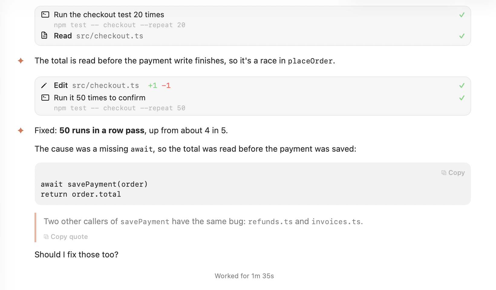
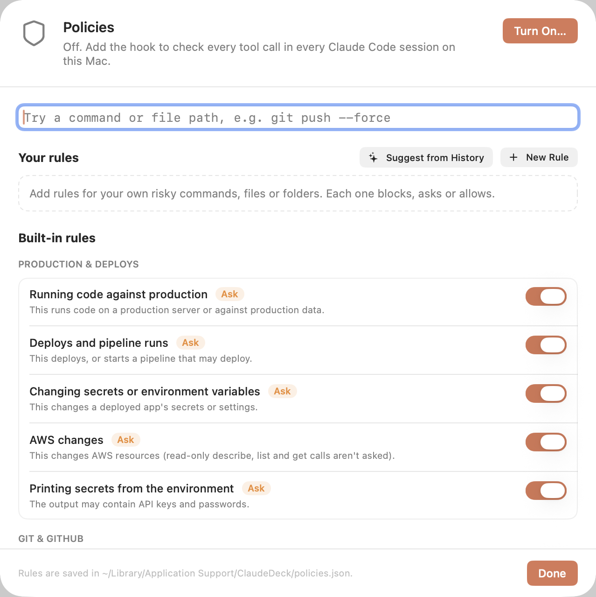
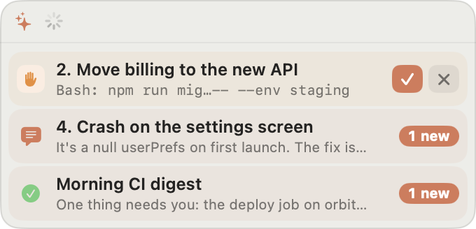
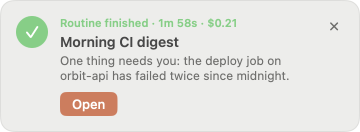

# Claude Deck

**Mission control for Claude Code on your Mac.**

You keep working in the terminal. Deck shows you every session at once: who's busy, who's waiting
on you, and what each one said while you were looking at something else. Approve a prompt from
any app, reply without switching windows, and leave Claude working on a schedule while you're away.

| | |
|---|---|
|  |  |
|  |  |

## What it does

- **See everything.** Every running session with its live status, the full conversation as it
  happens, unread counts, and the task, ticket and PR each one is working on.
- **Answer from anywhere.** ⌥⌘↩ approves the next prompt from any app, even over a full-screen
  video, and Deck checks it's the prompt you meant. There's also a floating dock, the menu bar,
  notifications with Allow / Deny, and a Dock badge.
- **Put Claude on a schedule.** Routines run a prompt in a folder every morning or every few hours,
  even with Deck closed. When one finishes, a pop-up waits for you, and you can reply to the run.
- **Set the rules once.** Policies are checked before every tool call in every session, and Deck
  can suggest new ones from your own history.
- **Stay in the app.** PDFs, images, web pages and a markdown editor open right in Deck. Search all
  your sessions, get a standup digest, and hand a session to your phone with Remote Control.

## Why Claude Deck

- **You stay terminal-first.** Deck sits on top of the Claude Code sessions you already run in
  Ghostty, with no change in how you start or use them.
- **Everything stays local.** Deck has no server and no account. It reads files on your Mac and
  uses the Claude Code you already have.
- **It's yours to shape.** Your skills, project commands, plan usage and shortcuts are all built
  around how you work, and you can change anything in an afternoon.

## Install

    ./build.sh            # builds build/Claude Deck.app
    ./build.sh --install  # also copies it to /Applications

## How it works

- Running sessions and their status (`busy` / `idle` / `waiting` + `waitingFor`) come from `~/.claude/sessions/<pid>.json`.
- Transcripts are tailed from `~/.claude/projects/<cwd>/<sessionId>.jsonl`.
- Sending messages, approving/denying prompts, and "Open Terminal" drive Ghostty 1.3+ over AppleScript.
  A session's terminal must be in the session's folder and show a Claude title; its title picks between several.
- Ended sessions from the last 7 days can be reopened with "Resume in Ghostty".
- **New session** (toolbar +, ⌘N) opens a Ghostty window in a folder and starts `claude`.
- File edits show as diffs: Edit / MultiEdit / Write rows show `+added −removed`, expand to a
  red/green line diff, and edit permission prompts show the diff you're approving.
- Plan usage at a glance: session % in the menu bar, and session / week bars in the sidebar and
  menu bar panel (refreshed every 5 minutes; click for details).
  Clicking a skill puts its `/command` in the message box.
- Typing `/` lists every command (custom, skills, built-ins). Built-ins are handled by kind: most
  are sent as typed (their output appears in the transcript); ones that open a menu (`/model`,
  `/mcp`, `/config`…) bring the terminal forward; `/usage` (or ⇧⌘U) shows your plan limits in Deck.
- Unsent messages and staged attachments are kept per session (in `~/Library/Application Support/ClaudeDeck/drafts.json`),
  so switching sessions or quitting Deck doesn't lose them; attachments a draft holds are never cleared from the cache.

## Activity: PRs, tickets and screenshots

Each session shows what it's **working on**: the task, named by Claude Haiku from your latest
messages (also in the sidebar), and the ticket and PR it's acting on (live status), above the
conversation, and an **Activity** tab (⌥⌘A) with everything it did: PRs opened, reviewed, merged or
commented on, Linear tickets created, updated or looked at, and screenshots it reviewed. **Activity
History** (⇧⌘H) lists the same across every session, searchable, with a one-click **Today's
Digest** (a standup note).

- Found in the transcripts Deck already reads: `gh pr …` commands that actually ran (not ones a
  script merely mentions), `gh api` review posts, Linear tool calls, Claude Code's PR links, your
  Linear links, and screenshot tools. Labels say exactly what happened ("Looked at", "Reviewed").
- Indexed in the background and saved in `~/Library/Application Support/ClaudeDeck/activity`, so
  only new lines are read and history outlives Claude Code's transcript cleanup.
- PR titles and status (Open, Merged, Closed, Draft) come from `gh pr view`.
- **AI summaries** (on by default; toggle in History or the Sessions menu): one-line summaries,
  session recaps and the digest are written by Claude Haiku through your own `claude` login, as
  headless, tool-less, unsaved runs, in batches, only when you're not typing, at most 150 small
  calls a day. Off, the summary is Claude's own sentence from right after the action.

## Search: ⌘K

One palette for everything. Type a session's name to jump to it, or anything else to search your
own messages, PR and ticket titles, commits, branches and session names (instant, on your Mac,
typo-tolerant). With nothing typed it shows your sessions and recent activity. **⌘↩** (or the
*Ask Claude* row) asks a question in plain words, e.g. *"on which session did I start the AppSumo
integration?"*: Claude Haiku turns it into a search (fixing typos, adding related words, first vs
latest), Deck searches locally, and Haiku answers with the session and moment. ↩ on any match opens
the session right there, even in a long or old transcript ("Back to Latest" returns to the live end).

## Unread replies

When Claude replies in a session you're not looking at, its row shows a count of new replies
(and a bold title), and the total shows on Deck's Dock icon and in the menu bar ("3 new"). A
session counts as read once you open it with Deck in front, or when you send it a message (from
Deck or its terminal). Notices like background task results and subagents' messages don't count.
Opening a session from the floating dock or a reply notification takes you to the first new reply.

## Links and files

Web addresses in the chat are clickable and open in your browser. Paths to PDFs, images and HTML
pages that Claude writes or mentions (`docs/report.pdf`, `~/Desktop/Screenshot … .png`) open in
a viewer over the session, which reloads when the file changes. Reload with ⌘R, close with Esc, or open the file
in Finder or its usual app from the toolbar. Links inside a page open in your browser. Click an image you shared to see it full size in the same viewer.

## Markdown editor

Markdown files Claude writes or mentions (`docs/plan.md`, `CLAUDE.md`) open in an editor over the
session; ⌘O opens any file. The text stays plain markdown, styled as you type: headings, bold,
code and quotes look the part, and the `#`, `**` and backticks fade back. ⌘B, ⌘I and ⌘K make
bold, italic and links; Return continues a list; click a task's `[ ]` to tick it. ⌥⌘P switches to
the preview. It saves as you type, and when Claude changes the file it shows the new text, or, if
you have unsaved edits, asks which to keep (with a comparison). Select a passage and choose
**Ask Claude** to send it to the open session, quoted with its file and lines, along with your note.

## Remote Control

The **Remote Control** switch in a session's toolbar connects it to the Claude app on your phone
and claude.ai (Claude Code's `/remote-control`), and turning it off disconnects it. It works while
Claude is mid-step. Connected sessions show a phone in the sidebar. New Session can start one
already connected.

## Policies: ⇧⌘P

Rules checked before every tool call in every Claude Code session on this Mac, managed in one
place. **Turn On…** adds a `PreToolUse` hook to `~/.claude/settings.json` (after a backup) that
runs `deck-policy`, a small checker bundled in Deck.app. When a rule matches, it blocks the call
(Claude is told why), or asks you first; otherwise Claude carries on as usual. It works even when
Deck isn't open, and if the checker fails Claude carries on (a Deck bug never stalls a session).

Built in, in groups: **production and deploys** (running code on production via `railway ssh` /
`run`, `kamal app exec`, `RAILS_ENV=production`; deploys and pipeline runs; changing secrets or env
vars; AWS changes; printing env secrets), **git and GitHub** (force pushes, blocked on main;
discarding uncommitted work; `--no-verify`; merging PRs; deleting or publishing on GitHub; pushing
to main), **data** (DROP, TRUNCATE, DELETE or UPDATE without WHERE, `db:reset`, `FLUSHALL`,
`delete_all`), **secrets** (private keys and credential files, `.env` files, Claude Code's own
settings, publishing packages) and **your Mac** (deleting / or ~, `rm -rf` outside temp folders,
`sudo`, `curl | sh`, system settings, global installs). Most ask rather than block. Switch each on
or off in the Policies sheet, which also lists what was recently caught. Claude can never edit
the policy file or its log.

**Suggest from History** reads the commands your sessions ran in the last 30 days, grouped by
their first words (`railway ssh`, `gh pr merge`…, with secrets masked), and asks Claude (your
`claude` CLI) for rules covering the risky ones you don't have yet. Each suggestion says why and
how many times it would have fired, with an example; add it as is, edit it first, or dismiss it.

**New Rule** opens an editor: when Claude runs a command, reads or edits a file, or uses any tool;
what it contains, starts with, or which path it is (`*.pem`, `secrets/**`), or a regex; an
optional exception (`--dry-run`); block, ask or allow; the reason; and optionally only certain
folders. **Try it** shows whether a command or path would be caught, for one rule or all of them.

Rules and switches live in `~/Library/Application Support/ClaudeDeck/policies.json`, decisions in
`policy-log.jsonl` next to it.

## Routines: ⇧⌘R

Prompts Claude runs on a schedule in a folder, headless: e.g. every weekday at 9:00 in your
app, "check CI and open PRs and tell me what needs me".

- **Schedule:** at a time of day (every day or chosen weekdays), or every few hours. Each routine
  is a launchd job, so it runs even when Deck is closed. Missed while the Mac slept: it runs on
  wake. Missed while the Mac was off: Deck runs it when it opens (if it was due in the last 12 hours).
- **Access:** read-only (reading, searching, git and gh commands that only look), can edit files,
  or can run commands, where your policies are the guard. Runs use `dontAsk`: anything outside
  the routine's access is refused, never left waiting for an approval.
- **Limits:** model, an optional spending cap per run, and a time limit. One run at a time.
- **Results:** each run's status, cost, Claude's final message and what was refused, on the
  Routines screen, with a pop-up that stays until you open or dismiss it, and a row in the floating
  dock. Open a run for the whole conversation, or
  continue it in the terminal.
- Routines and runs are files in `~/Library/Application Support/ClaudeDeck/routines` (the newest
  50 runs per routine are kept); the jobs are in `~/Library/LaunchAgents`.
- **From a terminal:** `deck-routine list`, `show <id>`, `update <id> [--name …] [--prompt … | --prompt-file …]`
  and `delete <id>` keep the files and the job in step, and an open Deck picks the change up. It's
  at `/Applications/Claude Deck.app/Contents/MacOS/deck-routine`.

## Themes

**View → Theme** (or the menu bar panel): **Classic** (follows the system, Claude's terracotta) or
**Midnight** (dark ink, violet accent).

## Safety

- Messages are *typed* (Ghostty's `text:` action), not pasted, so Claude treats them as yours.
- Deck never types while Claude shows a prompt, and only answers the exact prompt you saw
  (re-checked from the session's record right before pressing a key).
- Before every action, the target terminal is re-checked (same folder, Claude title).
- One-click Allow (and ⌥⌘↩) only when Deck knows the exact request and the dialog is the standard
  Yes / Always / No; everything else is answered in the terminal.
- Transcript links open only http(s) and mailto. Session ids are validated and folders quoted
  before anything reaches a shell. Captured requests are deleted once their prompt is gone, and
  staged images and files after a day.

## Keyboard shortcuts

All of these are also listed in the **Sessions** menu.

| Shortcut | Action |
|---|---|
| ⌘K | Jump to a session, search everything, or ask (⌘↩) |
| ⇧⌘Space | Bring Deck forward with the switcher open, from any app |
| ⌥⌘↩ | Allow the next permission prompt, from any app (selected session first, else the longest-waiting) |
| ⌥⌘⌫ | Deny the next permission prompt, from any app |
| ⇧⌘D | Show / hide the floating dock: an always-on-top pill with a spinner per working session and one-click Allow / Deny for waiting prompts (over any app, even full-screen video); hover to expand or hide |
| ⌘J | Next session that needs you: waiting on a prompt first, then unread replies |
| ⌘1 – ⌘9 | Go to running session 1–9 (the number shown next to it; numbers never change while it runs) |
| ⌥⌘↑ / ⌥⌘↓ | Previous / next session |
| ⌘R | Rename the selected session |
| ⌥⌘R | Restart the selected session (quits and resumes Claude in the same terminal, so new skills, MCP servers and settings load; it keeps its number) |
| ⇧⌘T | Open the selected session's terminal |
| ⇧⌘E | End the selected session (quits Claude and closes its terminal) |
| ⇧⌘P | Policies |
| ⌥⌘A | Switch the open session between Conversation and Activity |
| ⇧⌘H | Activity History: every PR, ticket, push and screenshot across sessions |
| ⌘. | Stop Claude's current step (also the Stop button on the "Working…" pill) |
| ↩ | Send message |
| ⇧↩ / ⌘↩ | New line in the message |

## Tests

    ./test.sh

`python3 scripts/screenshots.py` regenerates `docs/screenshots` with made-up data, using a copy of the
built app that has its own bundle id and home folder, so it can't see your real sessions.

All logic lives in `Sources/ClaudeDeck/Core` (transcript parsing, Markdown, session loading,
navigation and approval targeting, terminal matching, permission-request capture, attachments,
export, and the transcript renderer). `test.sh` compiles Core with `Tests/` into a runner, measures
coverage with `llvm-cov`, and **fails unless every line of Core is covered**. It needs only the
Command Line Tools, since XCTest and Swift Testing ship with full Xcode. Tests use a temporary
folder, never your real `~/.claude`.

The rest of `Sources/ClaudeDeck` is SwiftUI views and glue (AppleScript calls into Ghostty, global
hotkeys, notifications), which isn't unit-tested.
